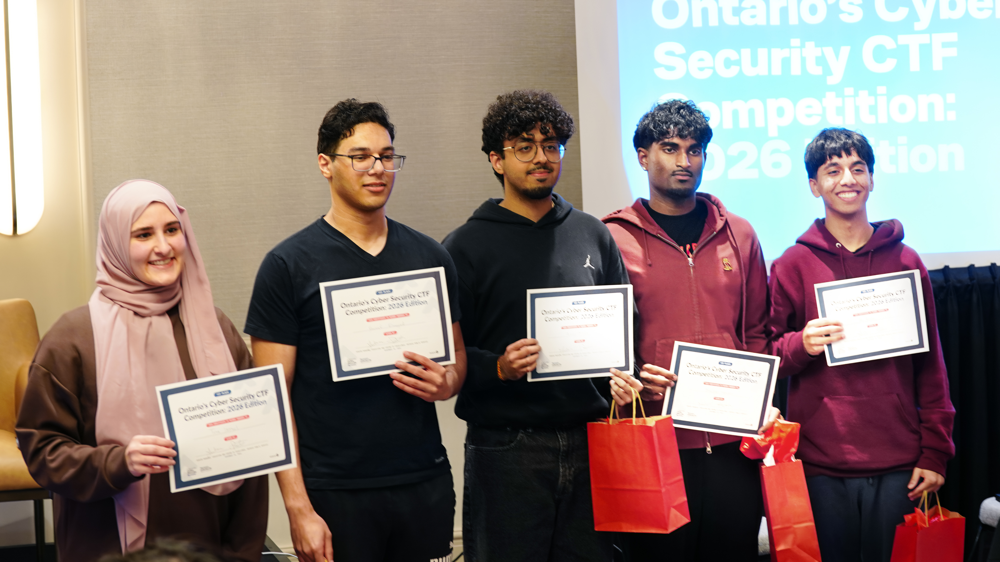
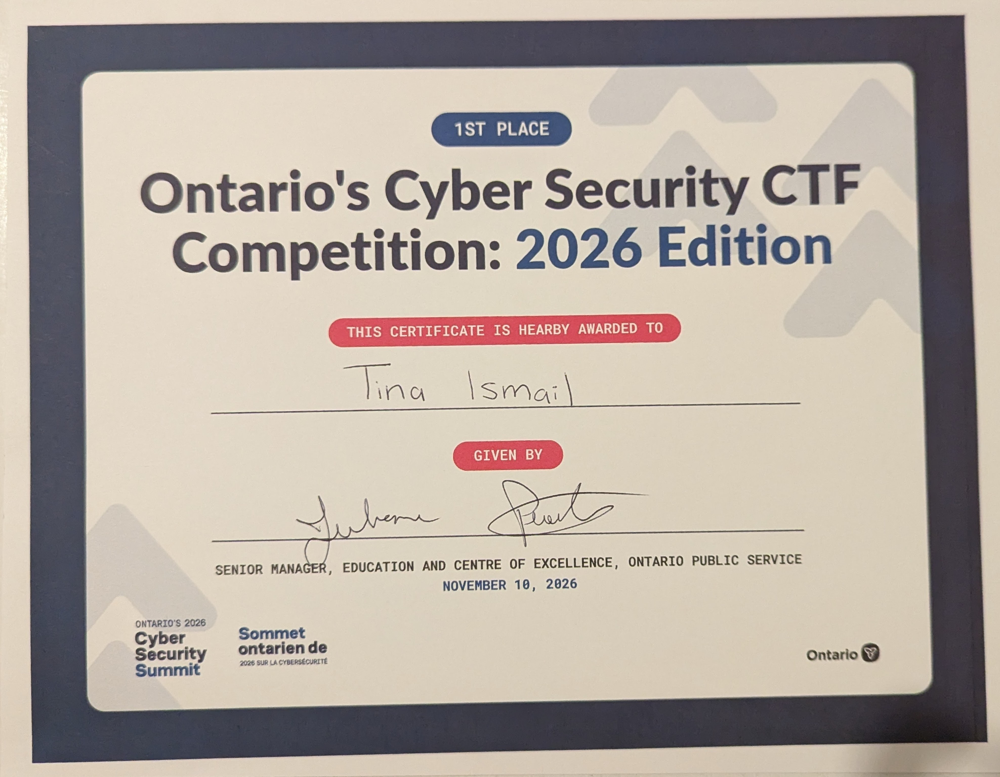

On November 10, 2026, my team, MacHackers, placed **first out of 14 teams** at the Ontario Cyber Security CTF held at the Marriott in Toronto. Unlike traditional Jeopardy-style or attack-defense competitions that focus heavily on offensive exploitation, this event centered on a realistic, defensive Blue Team scenario.

{: .img-fluid .rounded .shadow-sm width="800" }

Using the Mandiant ThreatSpace training platform integrated with the Google SecOps SIEM, we analyzed massive volumes of telemetry to piece together a multi-stage enterprise intrusion from the ground up. Finishing #1 on the leaderboard during the investigation phase allowed us to advance to the top-five finals, where we presented our executive briefing, timeline presentation, and comprehensive remediation strategy to the judges and took home the win.

# The Scenario: Unraveling an APT40 Intrusion

Our investigation centered on a simulated enterprise environment spanning two Active Directory domains, CORE.COM and DEV.CORE.COM, which had been compromised by APT40, a state-sponsored threat actor.

Using Google SecOps, we mapped the entire breach across the Mandiant Targeted Attack Lifecycle to understand how the attackers got in, how they moved, and what they took:

- **Initial Compromise:** The attackers entered through two vectors simultaneously. On the external web front, they exploited a file upload page to drop a PHP webshell onto `WEBSERVER`. At the same time, they hijacked a third-party partner remote desktop session to log directly into `JUMPHOST` (`10.1.11.10`).

- **Establishing a Foothold:** Once inside, they deployed a disguised spyware implant on `JUMPHOST` and configured a reboot-persistent backdoor cron job on `WEBSERVER`.

- **Privilege Escalation:** On `WEBSERVER`, they abused a misconfigured utility to escalate to `root`. On `JUMPHOST`, they bypassed Windows User Account Control. From there, they moved to `OPS2` (`10.1.5.11`), dumped credentials straight from memory, and cracked two Domain Admin passwords.

- **Internal Reconnaissance and Lateral Movement:** With elevated privileges, the attackers mapped domain trusts, internal file shares, and the firewall administration portal. Leveraging the stolen Domain Admin accounts, they spread across `OPS2` through `OPS4`, `DEV2`, `DEV4`, and `HR2`. A plaintext password left behind in `WEBSERVER` command history gave them the pivot they needed to breach `DEV4` (`10.1.8.13`) and enter the `DEV.CORE.COM` environment. They also accessed `fileserver.core.com` using stolen credentials to download the organization emergency break-glass admin vault.

- **Maintaining Presence:** To ensure long-term access across all 10 compromised hosts, APT40 configured a daily 3:00 AM scheduled task on `OPS4` (`10.1.5.13`), maintained an active Linux command-and-control agent on `WEBSERVER`, established hidden SMB channels between infected hosts including `DEV-DC`, and used the stolen break-glass credentials to execute their implant directly on the primary domain controller, `DC1`.

- **Completing the Mission:** With full control over both domains, the attackers executed DCSync attacks on both `DC1` and `DEV-DC` to dump every password hash in the enterprise. They archived sensitive research and development designs on `DEV2` (`10.1.8.11`) for exfiltration, and covertly leaked human resources data from `HR2` via DNS tunneling by encoding hexadecimal chunks into subdomains to blend in with normal traffic. Finally, they wiped their tracks and planted a decoy configuration file on `OPS3` to mislead incident responders.

## The Remediation Plan and the Detail That Won Over the Judges

After finishing first in the SIEM investigation phase, the top five teams had to pitch an executive summary and incident response plan. We structured our remediation roadmap into three distinct phases:

1. **Immediate Containment (Today):** Isolate all 10 compromised hosts (`WEBSERVER`, `JUMPHOST`, `OPS2`, `OPS3`, `OPS4`, `DEV2`, `DEV4`, `HR2`, `DC1`, and `DEV-DC`), sever third-party partner access to `JUMPHOST`, and block both the callback IP (`185.106.120.206`) and the DNS exfiltration domain (`msusanode.com`) at the perimeter.

2. **Short-Term Rebuild (This Month):** Because both domain controllers suffered DCSync compromises and break-glass credential theft, we recommended full domain rebuilds for `CORE.COM` and `DEV.CORE.COM` alongside wiping infected servers, stripping out the scheduled tasks and cron persistence, locking down file uploads on the web server, and enforcing Kerberos pre-authentication for all privileged accounts.

3. **Long-Term Prevention (Next Quarter):** Enforce multi-factor authentication on all partner and admin logins, move the break-glass admin vault completely offline, restrict the trust relationship between the two domains, and build high-fidelity SIEM alerts for DCSync replication, LSASS memory dumps, and anomalous DNS query volume.

### Why Resetting `krbtgt` Twice Was Our Highlight Moment

When presenting our Active Directory recovery steps, we made a point to emphasize that resetting all admin passwords and the `krbtgt` account password once is not enough. It has to be reset twice.

The judges loved that we explained the underlying mechanics of why this matters. Active Directory retains a history of two `krbtgt` keys, the current password hash and the immediate previous one, so active users with valid Kerberos Ticket Granting Tickets are not abruptly kicked out during a routine key rotation. If an attacker has already dumped the `krbtgt` hash via DCSync, a single reset leaves the compromised hash in the previous slot, allowing the threat actor to continue forging tickets. Resetting `krbtgt` twice, allowing time for replication in between, flushes the compromised key out of history entirely and invalidates every forged ticket in the environment.

## Final Thoughts

Participating in a SIEM-driven defensive CTF was a refreshing change of pace and a fantastic test of real-world incident response and threat hunting skills. Moving from raw log triage in Google SecOps to translating technical indicators of compromise into an executive briefing made for an incredible learning experience. Huge shout-out to my teammates on MacHackers for a phenomenal run!

<a href="https://www.linkedin.com/in/aliakber-raza/" target="_blank" rel="noopener" aria-label="Ali Raza's LinkedIn profile"><i class="fas fa-link" aria-hidden="true"></i></a>Ali Raza\\
<a href="https://www.linkedin.com/in/aryan-mistry-70722825b/" target="_blank" rel="noopener" aria-label="Aryan Mistry's LinkedIn profile"><i class="fas fa-link" aria-hidden="true"></i></a>Aryan Mistry\\
<a href="https://www.linkedin.com/in/shaeshan-kunalan/" target="_blank" rel="noopener" aria-label="Shaeshan Kunalan's LinkedIn profile"><i class="fas fa-link" aria-hidden="true"></i></a>Shaeshan Kunalan\\
<a href="https://www.linkedin.com/in/youssef-e-0b0bb21b6/" target="_blank" rel="noopener" aria-label="Youssef Elsayyad's LinkedIn profile"><i class="fas fa-link" aria-hidden="true"></i></a>Youssef Elsayyad

{: .img-fluid .rounded .shadow-sm width="300" }